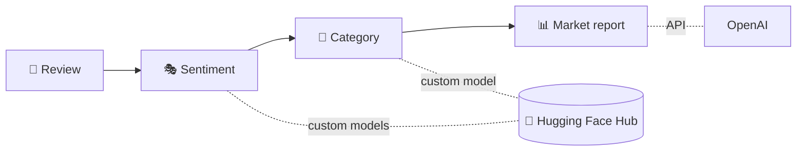
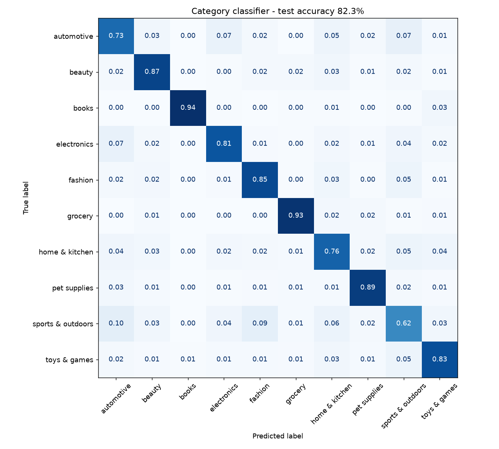

<div align="center">

# 🚀 Review Intelligence Dashboard

**Analyse product reviews with custom Transformer models and generate AI market reports.**


[What it does](#-what-it-does) · [Quick start](#-quick-start-in-3-steps) · [Requirements](#-system-requirements) · [Models](#-models) · [Training](#-training-the-category-classifier) · [Troubleshooting](#-troubleshooting)

</div>

---

## ✨ What it does

| Module | What you get | Needs OpenAI? |
|---|---|:---:|
| 🎭 **Sentiment Classifier** | Sentiment (positive / neutral / negative) with its confidence. You can compare 3 models at once. | ❌ |
| 🎲 **Category Classifier** | Product category out of 10 classes (electronics, home & kitchen, books…), with a model trained on 70,000 Amazon reviews. | ❌ |
| 📝 **Research Post** | Market research and a blog-style report, streamed and with citations. | ✅ |



- The models **download themselves** from Hugging Face the first time they are used and are cached.
- They are loaded into memory on demand and released after **180 s** of inactivity.

---

## 🏁 Quick start in 3 steps

> All you need is **[Docker Desktop](https://www.docker.com/products/docker-desktop/)** running and **[Git](https://git-scm.com/downloads)**. No Python install and no manual model download.

### 1️⃣ Clone the repository

```bash
git clone https://github.com/JTiiz/project-amazon-review-classifier-nlp-ai.git
cd project-amazon-review-classifier-nlp-ai
```

### 2️⃣ Build and start

```bash
docker compose up --build -d
```

⏱️ The first build takes a few minutes (it downloads Python, PyTorch and Transformers). Later starts take seconds.

### 3️⃣ Open the dashboard

👉 **http://localhost:8501**

That's it. Sentiment and Category work without any further setup.

> ℹ️ The **first** classification with each model takes a little longer, because it downloads the model from Hugging Face (0.3 to 0.5 GB per model). After that it is kept in a Docker volume and is not downloaded again.

### ➕ Optional: enable Research Post

This module uses the OpenAI API (paid). Create `frontend/.env` from the template:

```bash
cp .env.example frontend/.env
```

Add your key and restart:

```env
OPENAI_API_KEY=sk-...your_key...
```

```bash
docker compose up -d --force-recreate
```

> 🔒 `frontend/.env` is in `.gitignore` and is not copied into the Docker image. Without it the app still starts, and Research Post shows a warning.

---

## 💻 System requirements

| Resource | Minimum | Recommended | Why |
|---|---|---|---|
| 🧠 **RAM** | 8 GB | 16 GB | Each model takes ~0.5–1 GB of memory. Comparing the 3 sentiment models at once needs about 3–4 GB **for the container alone**. |
| 💾 **Free disk** | 6 GB | 10 GB | Docker image ≈ 1.8 GB + downloaded models ≈ 1.8 GB + build cache. |
| ⚙️ **CPU** | 4 cores | 8 cores | Inference runs on CPU; a prediction takes under a second once the model is loaded. |
| 🎮 **GPU** | Not needed | — | The app runs on CPU only. The GPU is only used if you want to retrain the model. |
| 🌐 **Internet** | Required | — | For the first build, the first download of each model and the OpenAI calls. |

| Software | Notes |
|---|---|
| 🐳 Docker Desktop 4.x+ | On Windows, with the **WSL 2** backend. Includes `docker compose`. |
| 🔧 Git | To clone the repository. |
| 🔑 OpenAI key | **Optional**, only for Research Post. |

> ⚠️ **Windows:** Docker Desktop limits the RAM available to WSL 2 (by default, half of the machine's). With 8 GB, make sure Docker has at least **5 GB**.

---

## 🧰 Useful commands

| Action | Command |
|---|---|
| ▶️ Start (without rebuilding) | `docker compose up -d` |
| 📜 Follow the logs | `docker logs -f ml-unified-intelligence` |
| ⏹️ Stop | `docker compose down` |
| 🔁 Rebuild after changing code | `docker compose up --build -d` |
| 🗑️ Also delete the downloaded models | `docker compose down -v` |
| 🧹 Free space from old builds | `docker builder prune` |

---

## 🤖 Models

All custom models are published on Hugging Face and declared in [`models/models.yaml`](models/models.yaml):

| Key | Task | Model | Test result |
|---|---|---|---|
| `lora_finetuned` | Sentiment | [jramduran/review-sentiment-roberta-lora](https://huggingface.co/jramduran/review-sentiment-roberta-lora) · RoBERTa-base + LoRA (r=16) | 80.7% accuracy · macro F1 0.754 |
| `roberta_finetuned` | Sentiment | [jramduran/review-sentiment-roberta-base](https://huggingface.co/jramduran/review-sentiment-roberta-base) · fully fine-tuned RoBERTa-base | — |
| `roberta_reference` | Sentiment | [cardiffnlp/twitter-roberta-base-sentiment-latest](https://huggingface.co/cardiffnlp/twitter-roberta-base-sentiment-latest) · public reference for comparison | — |
| `category` | Category | [jramduran/review-category-distilroberta](https://huggingface.co/jramduran/review-category-distilroberta) · DistilRoBERTa, 10 classes | **82.3% accuracy · macro F1 0.823** |

**How each model is resolved:**
1. If there is a folder in `models/` whose name contains the model's `keyword`, that local copy is used. Handy for testing a freshly trained model.
2. Otherwise it is downloaded from its Hugging Face `hub_id`.

---

## 🧪 Training the category classifier

The code is in [`training/`](training/) and is reproducible end to end.

| | |
|---|---|
| **Data** | 70,000 reviews from [Amazon Reviews 2023](https://huggingface.co/datasets/McAuley-Lab/Amazon-Reviews-2023), **7,000 per category** (title + text, no reviews shorter than 8 words) |
| **Split** | 80% train · 10% validation · 10% test (stratified) |
| **Base model** | `distilroberta-base` |
| **Training** | 3 epochs · lr 3e-5 · batch 32 · max 128 tokens · fp16 |
| **Hardware** | NVIDIA RTX 5060 Laptop (8 GB) · **7.3 minutes** |
| **Result** | **82.3% accuracy** · macro F1 0.823 on test |

<p align="center">
  
</p>

**Reading the results:**
- 🟢 Categories with their own vocabulary are almost perfect: **books 96%**, **grocery 92%**, **pet supplies 89%** (F1).
- 🟠 **sports & outdoors (64%)** is the hardest: it gets confused with *fashion* (sportswear) and *automotive* (outdoor accessories).
- Part of the error cannot be avoided: reviews like "arrived fast, good seller" say nothing about the product.

**Reproduce it** (requires [uv](https://github.com/astral-sh/uv); with an NVIDIA GPU it takes minutes, on CPU only, hours):

```bash
cd training
uv sync                              # PyTorch with CUDA 12.8
uv run python prepare_data.py        # downloads and balances the dataset (~150 MB)
uv run python train_category.py      # trains and saves to models/category-distilroberta/
```

`train_category.py` saves the model in `models/`, so the app uses it automatically instead of the one on Hugging Face. Metrics and the confusion matrix are saved in `training/reports/`.

---

## ⚙️ Configuration

| Variable | Default | Description |
|---|---|---|
| `OPENAI_API_KEY` | — | Only for Research Post (in `frontend/.env`). |
| `OPENAI_MODEL` | `gpt-4o-mini` | OpenAI model for the reports. |
| `MODEL_IDLE_SECONDS` | `180` | Seconds of inactivity before a model is released from memory. |
| `MODEL_MANAGER_VERBOSE` | `true` | Detailed model-loading logs. |
| `MODEL_ROOT` | `/models` | Path of the local models inside the container. |

---

## 🩺 Troubleshooting

<details>
<summary><b>❌ <code>Cannot connect to the Docker daemon</code></b></summary>

Docker Desktop is not running. Open it, wait until it shows *Engine running* and run the command again.
</details>

<details>
<summary><b>❌ <code>port is already allocated</code> (port 8501 in use)</b></summary>

Another process is using port 8501. Close it, or change the mapping in `docker-compose.yml` to `"8502:8501"` and open `http://localhost:8502`.
</details>

<details>
<summary><b>❌ The first classification takes very long or fails</b></summary>

The first time, the model is downloaded from Hugging Face. Check your connection and follow the progress with `docker logs -f ml-unified-intelligence`.
</details>

<details>
<summary><b>❌ The container restarts or exits while classifying</b></summary>

It is almost always lack of memory. Give Docker more RAM (*Settings → Resources*, or `.wslconfig` on Windows) or compare fewer models at once.
</details>

<details>
<summary><b>❌ Research Post shows "Operational Warning"</b></summary>

The OpenAI key is missing. Follow [Enable Research Post](#-optional-enable-research-post). If the key is set, check that it is correct and that the account has credit.
</details>

---

## 🛠️ Local development (without Docker)

Requires Python 3.12 and [uv](https://github.com/astral-sh/uv).

```bash
cd frontend
uv sync
uv run streamlit run Home.py
```

---

## 📂 Project structure

```text
.
├── docker-compose.yml        # Service orchestration
├── .env.example              # Environment variable template
├── models/
│   └── models.yaml           # Model registry (local or Hugging Face)
├── frontend/
│   ├── Dockerfile            # Two-stage build (uv + Python 3.12 slim, PyTorch CPU)
│   ├── Home.py               # Home page
│   ├── pages/                # Sentiment · Category · Research
│   ├── logic/                # Model management, OpenAI, styles
│   └── pyproject.toml        # App dependencies
└── training/
    ├── prepare_data.py       # Downloads and balances Amazon Reviews 2023
    ├── train_category.py     # DistilRoBERTa fine-tuning
    ├── upload_to_hub.py      # Publishes the models on Hugging Face
    └── reports/              # Metrics and confusion matrix
```
